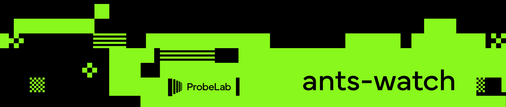

# Ants Watch

[](https://probelab.io)


`ants watch` is a DHT client monitoring tool. It is able to log the activity of all nodes in a DHT network by
carefully placing _ants_ in the DHT keyspace. For nodes to utilize the DHT they need to perform routing table maintenance tasks. 
These tasks consist of sending requests to several other nodes close to oneself in the DHT keyspace. `ants watch` ensures
that at least one of these requests will **always** hit one of the deployed ants. When a request hits an ant, we record information about the requesting peer like agent version,
supported protocols, IP addresses, and more.

**Supported networks** (selected via `--project`/`--network`):

* [Celestia](https://celestia.org/) — `celestia/mainnet`, `celestia/arabica-11`, `celestia/mocha-4`
* [Avail](https://availproject.org/) — `avail/mainnet-lc`
* [AGNTCY](https://agntcy.org/) — `agntcy/mainnet`
* Can be extended to support other networks using the [libp2p DHT](https://github.com/libp2p/specs/tree/master/kad-dht) by adding an entry to `bootstrappers.go`.


## Table of Contents

- [Quickstart](#quickstart)
- [Methodology](#methodology)
- [Configuration](#configuration)
- [Usage](#usage)
	- [Queen](#queen)
	- [Health](#health)
- [Ants Key Generation](#ants-key-generation)
- [Metrics](#metrics)
- [Development](#development)
- [Deployment](#deployment)
- [Related Efforts](#related-efforts)
- [Maintainers](#maintainers)
- [Contributing](#contributing)
- [License](#license)


## Quickstart

The queen needs:

| Requirement | Why |
| --- | --- |
| A public IP address, with UPnP or forwarded ports | Other nodes must be able to dial the ants. |
| A Nebula service (gRPC) at `ANTS_NEBULA_SERVICE_HOST:ANTS_NEBULA_SERVICE_PORT` | The queen asks it for the DHT servers of the network. |
| ClickHouse (optional) | Stores the requests. Without `ANTS_CLICKHOUSE_HOST`, the queen stores nothing. |

1. Start ClickHouse in Docker:

   ```shell
   just local-clickhouse
   ```

2. Copy the settings, which match that ClickHouse server, and load them:

   ```shell
   cp .env.example .env
   set -a; . ./.env; set +a
   ```

3. Start the queen with UPnP:

   ```shell
   go run ./cmd/ants queen --upnp
   ```

The queen applies the database migrations on startup.


## Methodology

* An `ant` is a lightweight [libp2p DHT node](https://github.com/libp2p/go-libp2p-kad-dht), participating in the DHT network, and logging incoming requests.
* `ants` participate in the DHT network as DHT server nodes. `ants` need to be dialable by other nodes in the network. Hence, `ants-watch` must run on a public IP address either with port forwarding properly configured (including local and gateway firewalls) or UPnP enabled.
* The tool releases `ants` (i.e., spawns new `ant` nodes) at targeted locations in the keyspace in order to _occupy_ and _watch_ the full keyspace.
* The tool's logic is based on the fact that peer routing requests are distributed to `k` closest nodes in the keyspace and routing table updates by DHT client (and server) nodes need to find the `k` closest DHT server peers to themselves. Therefore, placing approximately 1 `ant` node every `k` DHT server nodes can capture all DHT client nodes over time.
* The routing table update process varies across implementations, but is by default set to 10 mins in the go-libp2p implementation. This means that `ants` will record the existence of DHT client nodes approximately every 10 mins (or whatever the routing table update interval is).
* Depending on the network size, the number of `ants` as well as their location in the keyspace is adjusted automatically.
* Network size and peers distribution is obtained by querying an external [Nebula database](https://github.com/dennis-tra/nebula).
* All `ants` run from within the same process, sharing the same DHT records.
* The `ant queen` is responsible for spawning, adjusting the number and monitoring the ants as well as gathering their logs and persisting them to a central database.
* `ants-watch` does not operate like a crawler, where after one run the number of DHT client nodes is captured. `ants-watch` logs all received DHT requests and therefore, it must run continuously to provide the number of DHT client nodes over time.


## Configuration

Each flag also reads an environment variable. [`.env.example`](./.env.example) lists all of them.

### Queen

| Flag | Environment variable | Default | Description |
| --- | --- | --- | --- |
| `--project` | `ANTS_PROJECT` | `celestia` | The project to watch |
| `--network` | `ANTS_NETWORK` | `mainnet` | The network of the project to watch |
| `--user.agent` | `ANTS_USER_AGENT` | from project and network | The user agent of the ants |
| `--bucket.size` | `ANTS_BUCKET_SIZE` | `20` | The bucket size of the ants' DHT |
| `--first.port` | `ANTS_FIRST_PORT` | `6000` | The first port the ants listen on |
| `--num.ports` | `ANTS_NUM_PORTS` | `128` | The number of ports, and so the maximum number of ants |
| `--upnp` | `ANTS_UPNP` | `false` | Opens the ports with UPnP |
| `--public.ip` | `ANTS_PUBLIC_IP` | auto-detect | The public IPv4 the ants announce. `0.0.0.0` announces none. |
| `--key.path` | `ANTS_KEY_PATH` | `keys.db` | The file that stores the ant keys |
| `--certs.path` | `ANTS_CERTS_PATH` | `p2p-forge-certs` | The directory that stores the TLS certificates |
| `--crawl.interval` | `ANTS_CRAWL_INTERVAL` | `2h` | The time between two updates of the ants from the Nebula service |
| `--cache.size` | `ANTS_CACHE_SIZE` | `10000` | Agent versions and protocols cached in memory |
| `--throttle.timeout` | `ANTS_THROTTLE_TIMEOUT` | `5m` | The window that drops repeated requests (same peer, type and key). `0` turns it off. |
| `--dedup.cache.size` | `ANTS_DEDUP_CACHE_SIZE` | `100000` | Request hashes kept to find repeated requests |
| `--nebula.svc.host` | `ANTS_NEBULA_SERVICE_HOST` | `localhost` | The host of the Nebula service |
| `--nebula.svc.port` | `ANTS_NEBULA_SERVICE_PORT` | `8383` | The port of the Nebula service |
| `--batch.size` | `ANTS_BATCH_SIZE` | `1000` | Requests buffered before a write to ClickHouse |
| `--batch.time` | `ANTS_BATCH_TIME` | `20s` | The maximum time between two writes |

### ClickHouse

| Flag | Environment variable | Default | Description |
| --- | --- | --- | --- |
| `--clickhouse.host` | `ANTS_CLICKHOUSE_HOST` | empty | The ClickHouse host. Empty stores nothing. |
| `--clickhouse.port` | `ANTS_CLICKHOUSE_PORT` | `9000` | The native protocol port |
| `--clickhouse.database` | `ANTS_CLICKHOUSE_DATABASE` | empty | The database |
| `--clickhouse.user` | `ANTS_CLICKHOUSE_USER` | empty | The user |
| `--clickhouse.password` | `ANTS_CLICKHOUSE_PASSWORD` | empty | The password |
| `--clickhouse.ssl` | `ANTS_CLICKHOUSE_SSL` | `true` | Connects with TLS |
| `--clickhouse.cluster` | `ANTS_CLICKHOUSE_CLUSTER` | empty | The cluster name |
| `--clickhouse.migrationsTable` | `ANTS_CLICKHOUSE_MIGRATIONS_TABLE` | `schema_migrations` | The migrations table |
| `--clickhouse.migrationsTableEngine` | `ANTS_CLICKHOUSE_MIGRATIONS_TABLE_ENGINE` | `TinyLog` | The engine of the migrations table |
| `--clickhouse.migrations.replicatedTableEngines` | `ANTS_CLICKHOUSE_MIGRATIONS_REPLICATED_TABLE_ENGINES` | `false` | Keeps the `Replicated` table engines |
| `--clickhouse.migrations.multiStatement` | `ANTS_CLICKHOUSE_MIGRATIONS_MULTI_STATEMENT` | `false` | Applies migrations in multi-statement mode |
| `--clickhouse.migrations.multiStatementMaxSize` | `ANTS_CLICKHOUSE_MIGRATIONS_MULTI_STATEMENT_MAX_SIZE` | `10485760` | The maximum size of a multi-statement |

The queen applies the embedded migration files from `./db/migrations` on startup. It strips the `Replicated` prefix of the merge tree engines, because a single ClickHouse server, such as the one of `just local-clickhouse`, cannot run them. On a ClickHouse cluster, such as ClickHouse Cloud, set `ANTS_CLICKHOUSE_MIGRATIONS_REPLICATED_TABLE_ENGINES=true`.

`just local-clickhouse` starts the container `ants-clickhouse` on port `9000` without TLS, with the database `ants_local`, the user `ants_local` and the password `password`.

### Logging and Telemetry

| Flag | Environment variable | Default | Description |
| --- | --- | --- | --- |
| `--log.level` | `ANTS_LOG_LEVEL` | `info` | `debug`, `info`, `warn`, `error` |
| `--log.format` | `ANTS_LOG_FORMAT` | `text` | `text`, `json` |
| `--log.source` | `ANTS_LOG_SOURCE` | `false` | Adds the source code position to each log line |
| `--metrics.enabled` | `ANTS_METRICS_ENABLED` | `false` | Serves `/metrics` and `/healthz` |
| `--metrics.host` | `ANTS_METRICS_HOST` | `localhost` | The interface of the metrics server |
| `--metrics.port` | `ANTS_METRICS_PORT` | `6060` | The port of the metrics server |
| `--metrics.path` | `ANTS_METRICS_PATH` | `/metrics` | The path of the metrics endpoint |
| `--tracing.enabled` | `ANTS_TRACING_ENABLED` | `false` | Exports traces |
| `--aws.region` | `AWS_REGION` | empty | The AWS region the service runs in |


## Usage

Once the database is set up and migrations are applied, you can start the honeypot.

`ants-watch` needs to be dialable by other nodes in the network. Hence, it must run on a public IP address either with port forwarding properly configured (including local and gateway firewalls) or UPnP enabled.

### Queen

To start the ants queen, you can run the following command:

```sh
go run ./cmd/ants queen --project celestia --network mainnet --upnp # for UPnP
# or
go run ./cmd/ants queen --project celestia --network mainnet --first.port=<port> --num.ports=<count> # for port forwarding
```

Use `--project`/`--network` (default `celestia`/`mainnet`) to select the network. The queen fails to start if the pair has no configured bootstrap peers (see `bootstrappers.go`).

When UPnP is disabled, ports from `firstPort` to `firstPort + nPorts - 1` must be forwarded to the machine running `ants-watch`. `ants-watch` will be able to spawn at most `nPorts` distinct `ants`.

### Health

You can run a health check on the honeypot by running the following command:

```sh
go run ./cmd/ants health
```

The command requests `/healthz` from the metrics server. Its defaults are `127.0.0.1` and port `5999`, and the defaults of the metrics server are `localhost` and port `6060`. Set `ANTS_METRICS_PORT` for both commands, as `.env.example` does.

## Ants Key Generation

The queen ant periodically queries the [Nebula](https://github.com/dennis-tra/nebula) database to retrieve the list of connected DHT servers. Kademlia identifiers of these peers are then inserted into a [binary trie](https://github.com/guillaumemichel/py-binary-trie/). Using this binary trie, the queen defines keyspace zones of at most `bucket_size - 1` peers. One ant must be present in each of these zones in order to capture all DHT requests reaching the `bucket_size` closest peers to the target key.

Kademlia identifiers are derived from a libp2p peer id, which itself is derived from a cryptographic key pair. Hence generating a key matching a specific zone of the binary trie isn't trivial and requires bruteforce. All keys generated during the bruteforce are persisted on disk, because they may be useful in the future. When an ant isn't needed anymore, its key is marked as available for reuse. This also allows reusing the same peer ids for the ants across multiple runs of the honeypot.

## Metrics

With `ANTS_METRICS_ENABLED=true`, the queen serves Prometheus metrics on `ANTS_METRICS_HOST:ANTS_METRICS_PORT` at `/metrics`. The names carry the prefix `ants_`. Units are not set yet, and some names do not follow the ProbeLab naming rules.

| Metric | Type | Unit | Labels | Description |
| --- | --- | --- | --- | --- |
| `ants_ants_count` | gauge | none | none | Running ants |
| `ants_tracked_requests_count_total` | counter | none | `type`: DHT message type, such as `FIND_NODE`, `GET_PROVIDERS`, `PUT_VALUE` | Requests the ants received and kept |
| `ants_dropped_requests_total` | counter | none | none | Requests dropped as repeats within `ANTS_THROTTLE_TIMEOUT` |
| `ants_connect_total` | counter | none | `direction`: `Inbound`, `Outbound`, `Unknown` | Connections opened |
| `ants_disconnect_total` | counter | none | `direction`: `Inbound`, `Outbound`, `Unknown` | Connections closed |
| `ants_batch_inserter_rows_flushed_total` | counter | none | `table` | Rows written to ClickHouse |
| `ants_batch_inserter_rows_dropped_total` | counter | none | `table` | Rows dropped by a failed write |
| `ants_batch_inserter_flush_duration_seconds` | histogram | seconds | `table`, `trigger`: `size`, `interval`, `manual`, `stop` | Duration of a write |
| `ants_batch_inserter_flush_size` | histogram | none | `table`, `trigger` | Rows in a write |

The `batch_inserter` metrics come from the ClickHouse batch inserter of go-commons. The repository has no Grafana dashboard yet.

## Development

| Command | Does |
| --- | --- |
| `just` | Lists the recipes |
| `just build` | Builds every package |
| `just test` | Runs the tests. They need no services. |
| `just lint` | Checks formatting, `go fix`, `go vet` and `staticcheck`. The `justfile` pins the tool versions. |
| `just format` | Formats the code with `gofumpt` and applies `go fix` |
| `just ci` | Runs `lint`, `build` and `test`, as CI does |
| `just local-clickhouse` | Starts ClickHouse in Docker |
| `just docker`, `just docker-push` | Build the image `ants-sha<commit>` and push it to ECR |

Run `just ci` before you open a pull request.

## Deployment

ProbeLab runs ants-watch as 2 AWS ECS services in the cluster `prod-use1-cmi-ecs-cluster` (`us-east-1`):

| ECS service | Network |
| --- | --- |
| `prod-use1-cmi-ants-celestia-watch` | `celestia/mainnet` |
| `prod-use1-cmi-ants-agntcy-watch` | `agntcy/mainnet` |

The [`probelab-infra`](https://github.com/probe-lab/probelab-infra) repository holds the Terraform (`tf/ants.tf`, `tf/modules/ants`). Every merge to `main` builds the image `probelab:ants-sha<commit>` in ProbeLab's ECR. A pull request with the label `push-image` pushes its image too.

To deploy:

1. Add the label `deploy` to the pull request before you merge it. The merge then deploys both services.
2. Or deploy a commit of `main` by hand: `just deploy <commit>`, or run the CI workflow from the Actions tab with `deploy` set.

## Related Efforts

- [hydra-booster](https://github.com/libp2p/hydra-booster) - A DHT Indexer node & Peer Router

## Maintainers

- [@guillaumemichel](https://github.com/guillaumemichel)
- [@kasteph](https://github.com/kasteph)
- [@dennis-tra](https://github.com/dennis-tra).

## Contributing

Feel free to dive in! [Open an issue](https://github.com/probe-lab/ants-watch/issues/new) or submit PRs.

Standard Readme follows the [Contributor Covenant](http://contributor-covenant.org/version/1/3/0/) Code of Conduct.

## License

[PolyForm Strict License 1.0.0](LICENSE)
